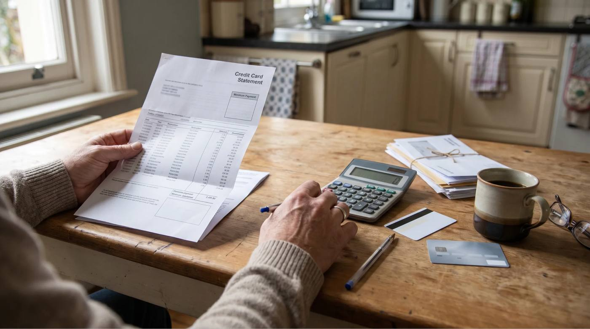
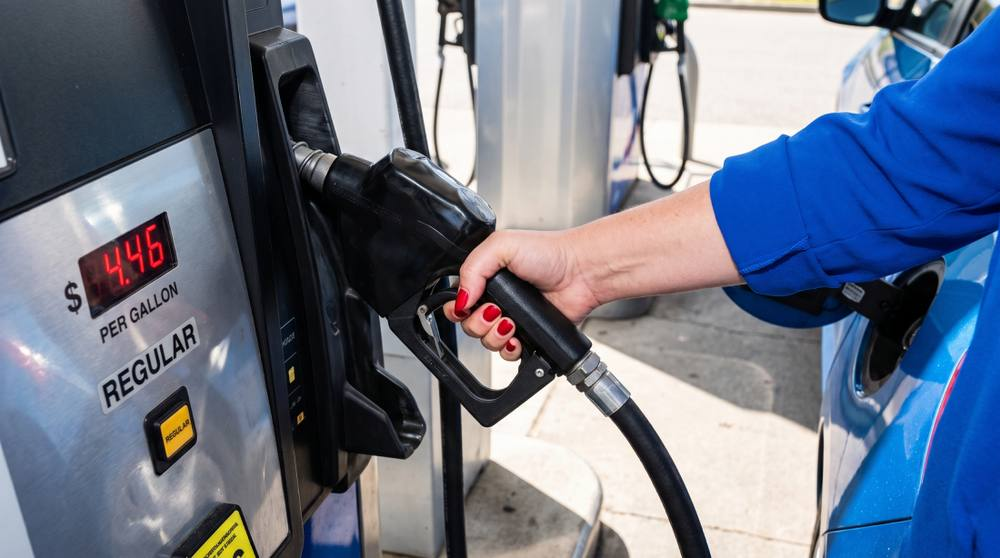

# Credit card debt just hit $1.25 trillion. Here's why so few people can pay it down.

Kicker: Explainer · Credit Cards
Byline: 6 min read | Data: Federal Reserve, NY Fed, LendingTree · [Sources](#sources)
Description: On the average $7,886 balance, most of the minimum payment goes to interest. Here's what it really covers, in four quick questions.
Tracking: da101_credit_cards

The average cardholder now carries a $7,886 balance — at a rate above 22 percent. | Photo illustration

The average cardholder now carries a balance of nearly $7,900 at an interest rate north of 22 percent — a combination that turns an ordinary emergency into a multi-year payoff.

::: takeaways The short version
- Total U.S. credit card debt reached **$1.252 trillion** in the first quarter of 2026 — up 63 percent since early 2021.
- The average cardholder carries a **$7,886 balance** at a **22.15% APR** on balances that are accruing interest.
- Because the minimum payment shrinks as the balance shrinks, paying only the minimum on that balance takes **about 23 years** and costs roughly **$13,500 more in interest** than the balance itself.
:::

## How did the balance get this high?

The last few years have quietly reshaped what a credit card is for. Rent, groceries, and insurance premiums climbed faster than paychecks for much of that stretch, and a growing share of households ran down the extra savings they'd built up earlier in the decade. For many, the card became the backstop — not for a single splurge, but for the gap between what comes in and what goes out.

Rent, groceries, and fuel costs climbed faster than paychecks for much of the last few years. | Photo illustration

The Federal Reserve's own survey data backs this up: roughly 45 percent of adult cardholders carried a balance for at least one month across 2025, rather than paying their statement in full. That's not a small, one-time emergency group. It's a meaningful share of the country making an interest payment every month as a matter of routine.

## What's the minimum-payment trap?

The math is where this gets painful. The average balance per cardholder sits at $7,886, and the average interest rate on balances that are actually accruing interest has climbed to 22.15 percent. Put those two numbers next to a minimum payment, and the debt barely moves.

::: stat
$146 | of your $224 minimum payment
goes straight to interest this month on the average $7,886 balance — only $79 actually reduces what you owe.
:::

In other words, most of the minimum is the cost of carrying the debt for another month. And because the minimum shrinks as the balance shrinks, the finish line keeps moving: paying only the minimum on the average balance takes about 23 years and costs roughly $13,500 more than the balance itself in interest. A fixed $302 a month instead clears the same balance in 3 years, for about $2,978 in interest total.

::: statement
Alt: Illustration of the Minimum Payment Warning box on a credit card statement: paying only the minimum on $7,886 takes about 23 years and costs an estimated $21,372 in total; paying $302 a month takes 3 years and costs $10,864.
Balance: $7,886.00
Minimum: $224.42
APR: 22.15%
- Only the minimum payment | **23 years** | **$21,372**
- $302 | 3 years | $10,864 (Savings = $10,508)
Caption: **The box on every statement.** Illustration based on the average U.S. card balance ($7,886) and APR (22.15%). Statements round payoff time to the nearest year.
:::

The warning doesn't change much. In a large study of card accounts, economists Benjamin Keys and Jialan Wang found that fewer than 1% switched to the three-year payment it suggests. About 29% of accounts regularly paid at or near the minimum.

There's another reason it gets missed. Researchers Linda Salisbury and Min Zhao point out that the warning is required on statements but typically isn't shown on the screens where people pay online.

::: tip Worth checking
See what a fixed monthly payment would actually cost you. [Comparing a fixed-rate debt consolidation loan against your current APRs](https://evafi.com/consolidation) takes a couple of minutes and doesn't affect your credit score.
:::

## Who's feeling it most?

The pain isn't evenly spread. Households carrying balances on multiple cards are the most exposed to rate increases, since a jump in APR compounds across every account at once. Delinquencies — payments 30 days or more past due — are still well below the levels seen during the 2008 financial crisis, but they've been drifting upward for several straight quarters, which is usually an early sign that minimum payments are becoming harder to meet, not easier.

## What are your options?

There's no single fix that works for every balance, but most households facing card debt are choosing from a similar short list.

::: ways
- **Pay down with a budget overhaul.** Redirecting any spare cash flow toward the highest-rate card first (or the smallest balance first, if momentum matters more) still works — it's just slow at today's rates.
- **0% balance-transfer card.** Can pause interest for 12–21 months, but requires decent credit, a transfer fee, and the discipline to clear the balance before the promotional rate ends.
- **Nonprofit credit counseling / DMP.** A certified counselor negotiates lower rates with your card issuers and consolidates payments into one monthly check — often over 3–5 years.
- **[Fixed-rate debt consolidation loan.](https://evafi.com/consolidation)** Rolls multiple card balances into a single installment loan, usually at a lower fixed rate than a card's 20%+ APR, with one predictable payment and a fixed payoff date.
:::

::: check Try this: the 30-second check
Open your last two statements and compare the total balance.
- Lower | You're making progress. Keep the payment steady.
- ! About the same | Your payments may be mostly covering interest.
- ! Higher | You may be in what's called the minimum payment trap.
If the number isn't moving, [see what a fixed-rate consolidation loan would cost instead →](https://evafi.com/consolidation)
:::

::: next Next step
See what a fixed-rate consolidation loan would actually cost you
A few minutes of comparing options won't affect your credit score.
[Compare your options](https://evafi.com/consolidation)
:::

::: soft
Already wondering where you stand? EvaFi, a debt consolidation service, offers a free 2-minute [Debt Consolidation Check](https://evafi.com/consolidation).
:::

::: related
Also on Debt Advice 101: [Personal loan debt hits a record $276 billion](https://claude.ai/artifact/KBnokriu3SMpHuuTUNQ8Hg) [Medical debt touches 100 million Americans](https://claude.ai/artifact/AJKh7sSuqadAgSx3Ks6Sr8)
:::

::: method How we calculated this
Figures use a $7,886 balance (LendingTree's average card debt per borrower with a balance, Q3 2025) at 22.15% APR (Federal Reserve rate on accounts assessed interest, Q2 2026). The minimum is modeled as 1% of the balance plus monthly interest, with a $25 floor, and assumes no new charges or fees. The fixed-payment path uses $302 a month, the amount that clears the balance in 36 months. Issuer formulas vary.
- [Federal Reserve Board, G.19 Consumer Credit](https://www.federalreserve.gov/releases/g19/current/)
- [LendingTree, 2026 Credit Card Debt Statistics](https://www.lendingtree.com/credit-cards/study/credit-card-debt-statistics/)
- [Federal Reserve Bank of New York, Household Debt and Credit Report, Q1 2026](https://www.newyorkfed.org/microeconomics/hhdc)
- [Keys and Wang, "Minimum Payments and Debt Paydown in Consumer Credit Cards"](https://www.stern.nyu.edu/sites/default/files/assets/documents/minpay_170120.pdf) (2017)
- [Salisbury and Zhao, Journal of Public Policy & Marketing](https://www.ama.org/research-insights/do-minimum-payment-warnings-help-consumers/) (2020)
- [CFPB, Regulation Z § 1026.7, periodic statement requirements](https://www.consumerfinance.gov/rules-policy/regulations/1026/7/)
:::

::: rail Next step
Compare fixed-rate debt consolidation offers
[Compare your options →](https://evafi.com/consolidation)
:::
