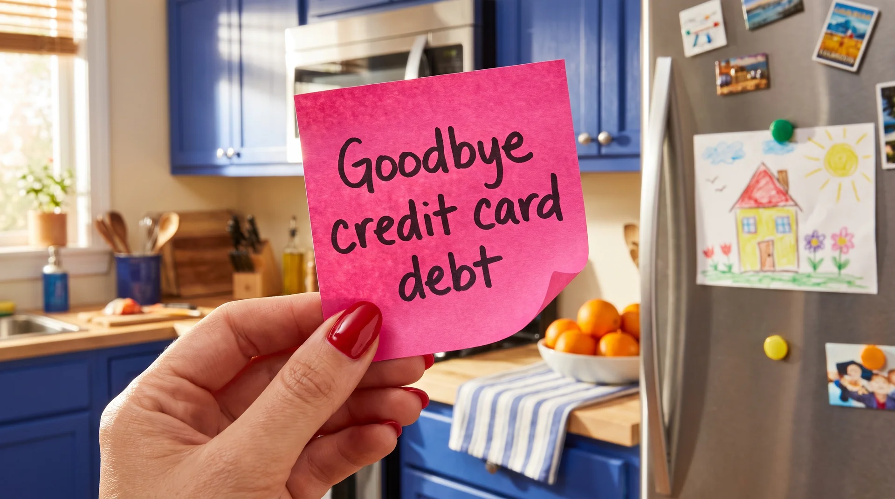

# Sample Article: Is {State}'s Minimum Payment Trap Catching Up To You?

This paragraph is the intro. Write plain paragraphs separated by a blank line.

The image above, placed right under the title, becomes the hero. Leave it out to keep the default hero.

## Why Minimum Payments Keep You Stuck

A paragraph in a section. Use {State} anywhere to insert the reader's state.

The same image file can be reused in any article with the same path.

## Your Options

Common paths people use:

- Consolidation loans roll balances into one payment.
- Balance transfer cards move debt to a low-rate card.
- Settlement programs negotiate with creditors.s

## What To Do Next

Checking costs nothing. Here's how it works:

1. Answer a few quick questions.
2. See whether you qualify.
3. Review your options.

[Take EvaFi's Free Quiz](https://evafi.relintex.dev/onboarding)
