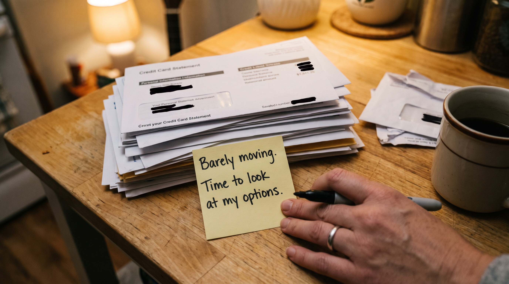

# {State} Residents: What to Know About $20k+ Debt

Kicker: Sponsored content · Credit card debt
Byline: Written by the Debt Advice 101 Editorial Team | Updated: This Week | 3 min read | [Sources](#sources)
Tracking: da101_adv_23
Part labels: off
Stats: U.S. credit card debt | $1.26T | NY Fed, Q2 2026 ;; Avg. APR, accruing balances | 22.15% | Federal Reserve, Q2 2026 ;; Avg. card debt per borrower | $6,610 | TransUnion, Q2 2026
Alt heroes: images/adv-23-hero-b.jpg | A hand holds a pink sticky note that reads: Goodbye credit card debt, in a bright kitchen. || images/adv-23-hero-c.jpg | A person highlights Minimum Payment on a credit card statement, next to a calculator and a cup of coffee.

Interest charges can make a big balance slow to pay down. | Photo illustration

See how EvaFi helps consumers review potential debt solutions, including consolidation loans and other available options.

::: takeaways Key takeaways
- A large card balance can be hard to pay down when interest takes a big share of each payment.
- Debt consolidation loans, debt settlement, working with your creditors and nonprofit credit counseling each work differently.
- A first look starts with sharing some basic information about your finances, before you choose any one path.
:::

If you're carrying thousands of dollars in credit card debt, you know how difficult it can be to make progress.

Between interest charges and monthly payments, paying down your balance can feel like an uphill battle.

::: link intro_link
Carrying $20,000 or more on your cards? [See what options you may have, starting with loan offers →](https://evafi.com/consolidation)
:::

## Why a $20,000 Balance Is So Hard to Move

Card interest is charged on the balance you carry each month. On a big balance, much of each payment can go to interest before any of it reaches what you owe.

Take a $20,000 balance at 22.15% APR, the recent average on cards charged interest, per the Federal Reserve. Interest alone comes to about $369 in the first month.

::: split Where a minimum payment goes in month one
$20,000 balance at 22.15% APR
- **$369** Interest | 369
- **$200** Toward the balance | 200
Callout: You pay $569. | But only $200 goes toward paying off your debt.
Note: Illustration only. Assumes a minimum payment of 1% of the balance plus that month's interest (22.15% APR divided by 12), and no new charges. Your card's terms may differ. Not an EvaFi loan or offer.
:::

Interest can take a big share of each payment. | Photo illustration

That's why a large balance can take so long to pay down, even when every payment is on time.

But there may be other ways to manage your debt.

## Explore Your Options With EvaFi

EvaFi helps you find debt consolidation options that may lower your interest and make your monthly payments easier to manage.

Rather than assuming one approach works for everyone, EvaFi helps you review options based on your financial situation.

::: link options_link
Want to see what could fit your situation? [Learn More About Your Options →](https://evafi.com/consolidation)
:::

## What Are Your Options?

There are several approaches worth understanding.

- Debt consolidation loans may combine multiple balances into one loan with a single monthly payment. The rates and terms you qualify for determine whether consolidation could help.
- Debt settlement involves negotiating with creditors to accept less than the amount owed. It can carry significant risks, including potential credit damage, fees, and collection activity.
- You may also consider contacting your creditors directly or working with a nonprofit credit counselor.

::: tip Good to know about debt settlement
- Fees can be high.
- Some card companies may refuse to settle, and some may sue to collect.
- Forgiven debt may be taxed as income.
Source: Consumer Financial Protection Bureau
:::

What works best depends on factors like your debt balance, income, credit history, and financial goals.

::: quiz Start here
Free · About 2 minutes
About how much do you owe across all your cards?
- Under $5,000 | under-5k
- $5,000 – $9,999 | 5-10k
- $10,000 – $19,999 | 10-20k
- $20,000 – $34,999 | 20-35k
- $35,000 or more | 35k-plus
Link: https://evafi.com/consolidation
Check: Tap one to see which options may fit your balance.
:::

## Checking Your Options Starts With a Simple Step

If you're interested in learning what may be available, you can start by sharing some basic information about your financial situation.

An EvaFi agent can help review potential options with you.

::: quiz Your options with EvaFi
Free · About 2 minutes
Not sure which path fits you?
Share some basic information, and an EvaFi agent can check for any available loan offers first, then review other options with you if a loan isn't the right fit. Not everyone will get an offer, and results vary with your situation.
[Compare my options](https://evafi.com/consolidation)
How it works: EvaFi isn't a lender. It connects you with options from its financial partners and may be paid by them. EvaFi or its partners may contact you about your options.
:::

There's no need to decide on a particular debt solution before you begin exploring.

::: link apply_link
Ready to start an application? [Apply to Review Your Options →](https://evafi.com/onboarding)
:::

Applying does not guarantee approval or eligibility. Available options depend on your financial circumstances and applicable program requirements.

::: next Your next step
See what debt solutions may be available to you, from loan offers to other options.
Start by sharing some basic information about your debt.
[See my options](https://evafi.com/consolidation)
:::

::: method Sources
- [Federal Reserve Bank of New York, Household Debt and Credit Report, Q2 2026](https://www.newyorkfed.org/microeconomics/hhdc) ($1.26 trillion)
- [TransUnion, Q2 2026 Credit Industry Insights Report](https://newsroom.transunion.com/Q2-2026-CIIR/) ($6,610 average card debt per borrower)
- [Federal Reserve Board, G.19 Consumer Credit](https://www.federalreserve.gov/releases/g19/current/) (22.15% average APR on accounts assessed interest, Q2 2026; used in the $20,000 illustration)
- [CFPB, "What is a debt relief program and how do I know if I should use one?"](https://www.consumerfinance.gov/ask-cfpb/what-is-a-debt-relief-program-and-how-do-i-know-if-i-should-use-one-en-1457/) (debt settlement trade-offs)
:::

::: rail Your options with EvaFi
$20,000+ in card debt? Review your options with EvaFi.
An EvaFi agent can check for any available loan offers first, then review other options with you if a loan isn't the right fit. Not everyone will get an offer.
[Explore my options →](https://evafi.com/consolidation)
:::
